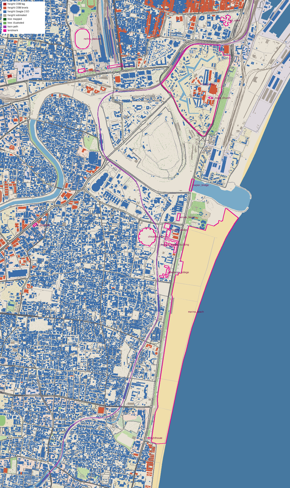

# Marina, Live: data validation report

Generated 2026-11-11 by `scripts/report.py`.

## Area

Bbox: south 13.034, west 80.262, north 13.09, east 80.296 (about 6.2 x 3.7 km). The brief's box was 13.040 to 13.090 N and 80.262 to 80.292 E. The south edge moved to 13.034 because the Marina lighthouse (OSM way 211436935) sits at 13.03974 N, and the east edge moved to 80.296 so open sea runs along the whole coast.

## Sources and reachability

| Source | URL | Result |
|---|---|---|
| OpenStreetMap via Overpass | https://overpass-api.de/api/interpreter (plus lz4. and z. aliases) | OK. Needs a User-Agent header (plain requests get 406); busy periods answer 502/504, handled by retries |
| Overture Maps buildings | s3://overturemaps-us-west-2/release/2026-10-21.0/theme=buildings | OK, read with DuckDB bbox filter |
| Google Open Buildings 2.5D Temporal (2023) | https://storage.googleapis.com/open-buildings-temporal-data/v1/ | OK. Two 1.4 to 1.6 GB tiles cover the box; only our window was range-read from the 2 m overview |
| Mapzen Terrain Tiles (Terrarium) | https://s3.amazonaws.com/elevation-tiles-prod/terrarium/14/ | OK, 12 tiles |

No source was blocked.

## OSM feature counts inside the bbox

| Layer | Count |
|---|---:|
| buildings (ways) | 10,337 |
| buildings (relations) | 56 |
| buildings with building:levels | 947 |
| buildings with height | 4 |
| building parts | 27 |
| roads: trunk/primary/secondary | 421 |
| roads: tertiary/residential/other | 2,346 |
| paths: footway/path/pedestrian/steps | 408 |
| rail ways (rail/light_rail/subway) | 161 |
| rail ways on bridges | 27 |
| platforms | 32 |
| coastline ways | 5 |
| beach/sand areas | 4 |
| water areas | 39 |
| waterways | 19 |
| parks/gardens | 67 |
| pitches/sports areas | 38 |
| landuse areas | 308 |
| trees (nodes) | 334 |
| tree rows | 0 |
| street lamps | 19 |
| traffic signals | 72 |
| crossings | 35 |
| bus stops | 100 |
| place names | 22 |

## Landmarks

| Landmark | Found | OSM | Name in OSM | Inside | Edge (m) |
|---|---|---|---|---|---:|
| MA Chidambaram Stadium (Chepauk) | yes | relation/60961 | MA Chidambaram Stadium | yes | 1,821 |
| Chennai Lighthouse (Marina) | yes | way/211436935 | சென்னை மெரினா கலங்கரை விளக்கம் | yes | 635 |
| LIC Building, Anna Salai | yes | way/1110170916 | Life Insurance Corporation | yes | 444 |
| Chepauk railway station | yes | node/2486239287 | Chepauk | yes | 1,671 |
| Chennai Central | yes | node/2481969291 | Puratchi Thalaivar Dr. M. G. Ramachandran Central | yes | 838 |
| Jawaharlal Nehru Stadium (Periamet) | yes | way/1241304916 | Jawaharlal Nehru Stadium | yes | 493 |
| Marina Beach | yes | way/22902280 | Marina Beach | yes | 1,314 |
| Fort St George | yes | way/1178009706 | Fort St. George | yes | 1,069 |
| Napier Bridge | yes | way/28295242 | Napier Bridge | yes | 1,259 |
| Madras High Court | yes | way/34326333 | Madras High Court | yes | 330 |
| Ripon Building | yes | relation/60184 | Ripon Building - Greater Chennai Corporation | yes | 897 |
| Chepauk Palace | yes | relation/14377429 | Chepauk Palace | yes | 1,555 |
| Presidency College | yes | relation/14377740 | Presidency College, Chennai | yes | 1,639 |
| Senate House | yes | way/23894473 | Senate House | yes | 1,418 |
| PWD building | yes | way/31897155 | Public Works Department | yes | 1,501 |
| St Mary's Church, Fort | yes | way/28746263 | St. Mary's Church | yes | 1,011 |
| Fort St George flagstaff | no | | | | |
| Kamarajar Salai (road) | yes | way/369656802 | Kamarajar Salai | yes | 1,541 |
| Anna Salai (road) | yes | way/28138962 | Anna Salai | yes | 1,546 |

Edge is the distance to the nearest bbox edge.

Notes:
- Chennai Central: OSM maps the platform roofs but not the red heritage building. Its footprint (190 x 28 m along the frontage roof, way 214739119) is illustrated.
- Madras High Court and Presidency College are campus polygons in OSM. Their models replace only the main blocks (ways 369960494 and 31900265).
- The Fort St George flagstaff is not mapped. The fort walls are (13 `city_wall` ways).

## Build

**Buildings: 24,898**

| Footprint source | Buildings |
|---|---:|
| google_open_buildings | 11,528 (46%) |
| openstreetmap | 10,346 (42%) |
| microsoft_ml | 3,024 (12%) |

| Height source | Buildings |
|---|---:|
| google_open_buildings_2p5d_2023 | 19,077 (77%) |
| estimated | 4,868 (20%) |
| osm_levels_x_3.1m | 950 (4%) |
| osm_height | 3 (0%) |

Where a building has both an OSM level count and a Google 2.5D height (891 buildings), they differ by 3.09 m on average and Google reads 1.04 times the OSM value at the median. Estimates use the median measured height within 70 m, clamped by building type.

Overture ML footprints kept: Google 11,835, Microsoft 3,093. Dropped: 2 overlapping OSM, 375 on water, sand, pitches or roads, 21 under 10 m2.

| Layer | Mapped | Illustrated |
|---|---:|---:|
| Trees | 334 | 15,752 |
| Street lamps | 13 | 6,713 |

Roads: 367.7 km. Rail: 70.3 km. Traffic paths: 125. Landmarks with hand models: 14.

Trains (illustrated, on mapped track):
- MRTS towards Velachery: 8.3 km, stops: Park Town, Chintadaripet, Chepauk, Thiruvallikeni, Light House, Mundakakanni Amman Koil
- MRTS towards Chennai Beach: 8.4 km, stops: Thirumayilai, Mundakakanni Amman Koil, Light House, Thiruvallikeni, Chepauk, Chintadaripet, Park Town
- Train out of Chennai Central: 0.7 km, stops: none

## Output size

| File | Size |
|---|---:|
| public/data/world.pack (gzip) | 1.09 MB (2.02 MB unpacked) |
| public/data/scene.json | 39 kB (12 kB gzip) |

## Preview

Building colours show the height source (dark red OSM tag, orange OSM levels, blue Google 2.5D, grey estimated).

